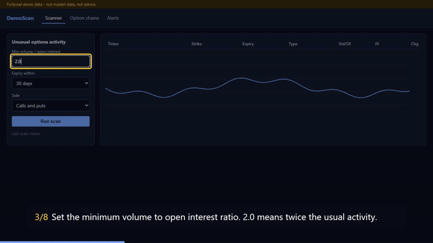

# scripted-training-video-proof

A training video is generated from a script file. You do not record anything by hand. Playwright drives the real app in a headless browser and records it. Remotion then adds a numbered caption and a highlight box on the element each step talks about. When the UI changes, you re-run the script and get an updated video.



Full render: [docs/unusual-options-scan.mp4](docs/unusual-options-scan.mp4) (25 s, 1080p, H.264).

The app is a toy options scanner with **fictional data** ([app/scanner.html](app/scanner.html)). Point `url` at your own app instead.

## The script

One JSON file per feature. An LLM can draft it, and a human can edit it. The narration and the browser actions sit in the same file:

```json
{ "action": "fill", "target": "min-vol-oi", "value": "2.0",
  "text": "Set the minimum volume to open interest ratio. 2.0 means twice the usual activity.",
  "holdMs": 3400 }
```

The supported actions are `caption`, `highlight`, `click`, `fill` and `select`. `target` is a `data-testid`, not a CSS path. A visual redesign does not break the library as long as the test ids stay.

## Why a script fails before it records

A script drafted by an LLM can name an element that does not exist, or a row that only appears after a step that changed. Without a check, you find out after rendering a broken video. Here the script is checked in two layers:

1. **Schema.** Unknown actions, missing targets or values, empty narration and hold times outside 500–15000 ms are rejected. The error names the step index.
2. **Dry run against the live app** (`--check`). Every step runs in the browser without recording. A missing target stops the run and names the step:

```
FAIL lesson: steps[4] (click): target "run-scann" not found on the page
```

A dry run takes about a second. The same check can run in CI on every app release, which tells you which lessons are now stale.

## Run

```bash
npm ci
npx playwright install chromium-headless-shell
npm run check    # dry run, no video
npm run video    # out/unusual-options-scan.mp4
npm test         # 11 tests: schema + dry runs against the app
```

Node 22 or newer. On its first render, Remotion downloads its own headless browser.

## Layout

| Path | What it does |
|---|---|
| `lib/script.mjs` | Script schema and validation |
| `lib/record.mjs` | Runs the steps with Playwright, records the video and writes each step's time and element position to `timeline.json` |
| `remotion/index.jsx` | Composition: recording + highlight box + numbered caption + progress bar |
| `bin/make-video.mjs` | CLI: `--check` or the full render |

## Licensing note

Remotion has its own license. It is free for individuals and small companies, and larger companies need a paid company license. Check [remotion.dev/license](https://www.remotion.dev/license) before using it commercially. This repository is MIT.
